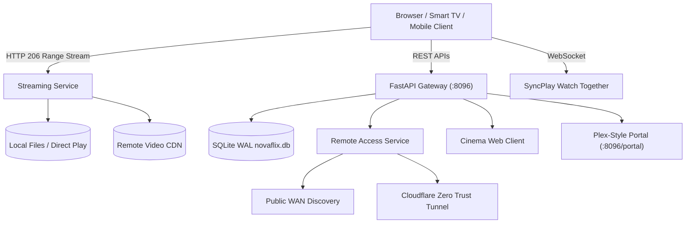

<div align="center">

# 🎬 NovaFlix
### The Sovereign Open-Source Media Platform | Next-Gen Alternative to Plex, Jellyfin & Emby

[](https://python.org)
[](https://fastapi.tiangolo.com)
[](https://docker.com)
[](https://developer.mozilla.org/en-US/docs/Web/HTTP/Range_requests)
[](LICENSE)
[](CONTRIBUTING.md)

<p align="center">
  <b>Combining the cinematic elegance of Plex, the open freedom of Jellyfin, and the raw performance of Emby.</b><br>
  Featuring 4K HDR Direct Play, HTTP 206 Range streaming, built-in seamless remote access, SyncPlay (Watch Together), multi-user PIN profiles, and a Plex-style download portal for Windows, macOS, Linux, and Docker.
</p>

[Features](#-key-features) • [Comparison Matrix](#-feature-comparison) • [Quick Start](#-quick-start) • [Architecture](#-architecture) • [Download Matrix](#-download-matrix) • [API Reference](#-rest-api)

---

</div>

## 🌟 Overview

**NovaFlix** was designed to solve the frustrations of the modern personal media ecosystem:
- **Plex** has become bloated with unwanted ad-supported free TV, paywalled features behind Plex Pass, and mandatory centralized cloud dependencies.
- **Jellyfin** is fully open-source but suffers from a dated web UI, cumbersome remote access setups, and desyncing SyncPlay.
- **Emby** locks hardware transcoding, offline downloads, and core features behind a proprietary Emby Premiere subscription.

**NovaFlix is 100% Free & Open Source**: Zero ads, zero paywalls, zero cloud tracking, and ultra-low memory usage (~55 MB RAM).

---

## ⚡ Key Features

- **🎬 Glassmorphic Cinema Web Client**: Modern dark UI with sweeping hero backdrops, smooth carousels, IMDb rating badges, and cast & crew information.
- **⚡ Direct Play & HTTP 206 Partial Content Streaming**: Fast seek times with zero buffer stalls using standard byte-range requests.
- **🌐 Built-in Zero-Conf Remote Access**: Instant public WAN IP discovery, Cloudflare Zero Trust tunnel guidance, and secure shareable links for family and friends outside your home network.
- **👥 SyncPlay (Watch Together)**: Watch movies and TV shows in real-time synchronization with friends across remote locations, complete with integrated text chat.
- **🔐 Multi-User Profiles & Parental Controls**: Admin, Family, and Kids profiles with 4-digit PIN locks and age-rating filtering (`G`, `PG`, `PG-13`, `R`, `ALL`).
- **📥 Plex-Style Multi-Platform Download Portal**: An included landing page (`/portal`) with direct downloads for Windows (`.exe` / `.zip`), macOS (`.dmg`), Linux (`.deb` / `.rpm`), and Docker.
- **⏱️ Continue Watching & Watchlist**: Resumes playback automatically across sessions.
- **💾 Asynchronous SQLite WAL Engine**: High-concurrency database storage without thread contention.

---

## 📊 Feature Comparison

| Capability | NovaFlix | Plex | Jellyfin | Emby |
| :--- | :---: | :---: | :---: | :---: |
| **100% Free & Open Source** | ✅ **Yes** | ❌ Proprietary (Plex Pass) | ✅ Yes | ❌ Freemium (Premiere) |
| **Third-Party Commercial Ads** | 🛡️ **Zero Ads Ever** | ❌ Invasive ads & free TV | 🛡️ Zero Ads | ⚠️ Upgrade banners |
| **Modern Cinema UI** | ✅ **Glassmorphic** | ⚠️ Cluttered / Ad heavy | ❌ Basic / Dated CSS | ⚠️ Traditional grid |
| **4K Direct Play & Range Streaming**| ✅ **Included Free**| ⚠️ Restricted without Pass | ✅ Included | ⚠️ Premiere feature |
| **Built-in Remote Access & Relay** | ✅ **Built-in** | ⚠️ Requires Plex Cloud Auth | ❌ Manual reverse proxy | ⚠️ Emby Connect |
| **SyncPlay (Watch Together) + Chat**| ✅ **Built-in** | ⚠️ Basic Watch Together | ⚠️ Frequent desyncs | ❌ No native chat |
| **Multi-User Profiles + PIN Lock** | ✅ **Built-in** | ⚠️ Requires Plex Home Pass | ✅ Built-in | ⚠️ Premiere feature |
| **Memory Footprint** | **~55 MB** | ~450 MB+ | ~220 MB (.NET) | ~260 MB (.NET) |

---

## 🚀 Quick Start

### Option 1: Windows 1-Click Launch

1. Clone or download NovaFlix:
   ```powershell
   git clone https://github.com/digdast/novaflix.git
   cd novaflix
   ```
2. Double-click **`run.bat`** (or run `python -m novaflix.main` in PowerShell).
3. Open your browser:
   - **Cinema Web Client**: [http://localhost:8096](http://localhost:8096)
   - **Showcase & Download Portal**: [http://localhost:8096/portal](http://localhost:8096/portal)

---

### Option 2: Docker & Docker Compose (Homelab / Linux / Unraid)

```bash
git clone https://github.com/digdast/novaflix.git
cd novaflix

docker-compose up -d
```

---

### Option 3: Linux / macOS Standalone

```bash
git clone https://github.com/digdast/novaflix.git
cd novaflix

pip3 install -r requirements.txt
./run.sh
```

---

## 🏛️ Architecture



---

## 📦 Multi-Platform Download Matrix

NovaFlix provides direct installation packages for all major operating systems:

| Platform | Format | Description |
| :--- | :--- | :--- |
| **Windows** | `.exe` Installer | Official 64-bit setup for Windows 10, 11, and Windows Server |
| **Windows** | `.zip` Portable | Zero-installation portable archive |
| **macOS** | `.dmg` Universal | Universal binary for Apple Silicon (M1/M2/M3/M4) and Intel x86_64 |
| **Debian / Ubuntu**| `.deb` Package | Native package with systemd service for Ubuntu and Debian |
| **RHEL / Fedora** | `.rpm` Package | RHEL, Fedora, Rocky Linux, and AlmaLinux packages |
| **Docker** | Container | Official multi-arch Docker image with hardware acceleration hooks |

---

## 📡 REST API Reference

| Method | Endpoint | Description |
| :--- | :--- | :--- |
| `GET` | `/api/media/featured` | Fetches current hero featured movie with backdrop and metadata |
| `GET` | `/api/media/movies` | Returns paginated list of movies with search and genre filtering |
| `GET` | `/api/media/shows` | Returns TV series catalog with seasons and episode trees |
| `GET` | `/api/media/item/{id}` | Detailed media modal metadata, ratings, cast, and stream links |
| `GET` | `/api/media/continue` | User-specific continue watching queue with progress percentages |
| `POST`| `/api/media/progress` | Updates playback position in seconds for resume functionality |
| `GET` | `/stream/{item_id}` | Direct Play streaming with HTTP 206 Partial Content Range support |
| `GET` | `/subtitles/{item_id}`| Returns WebVTT subtitle stream for HTML5 video players |
| `GET` | `/api/system/remote` | Fetches WAN IP, LAN IP, remote access status, and share link |
| `WS`  | `/ws/syncplay/{room_id}`| Real-time WebSocket synchronization room and live chat |
| `GET` | `/portal` | Plex-style product showcase and download portal |

---

## 📄 License

Licensed under the **MIT License**. Free for homelab, personal, and enterprise deployment.
Contributed with ❤️ by [digdast](https://github.com/digdast).
