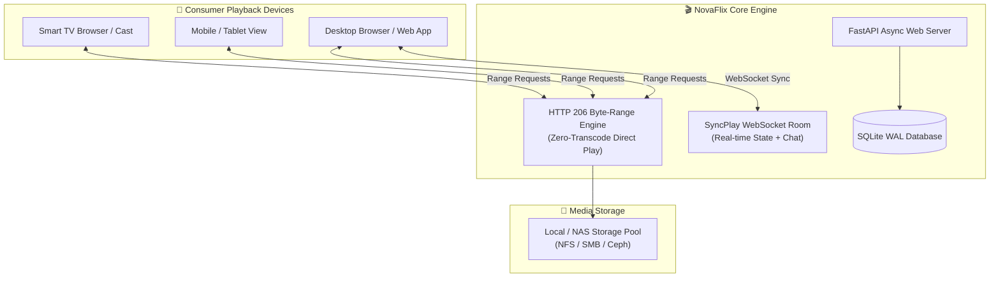

<div align="center">

# 🎬 NovaFlix

### The Sovereign Open-Source Media Platform | Next-Gen Alternative to Plex, Jellyfin & Emby
**4K HDR Direct Play, HTTP 206 Partial Content Streaming, Built-in Zero-Conf Remote Access, SyncPlay Watch Together, and Multi-User PIN Profiles.**

<p align="center">
  
  
  
  
  
</p>

</div>

---

## 📸 Production Preview

*Cinematic media library catalog: high-resolution movie & TV backdrops, real-time metadata, and instant streaming player.*

![NovaFlix Streaming Catalog]

---

## 🌟 Overview

**NovaFlix** solves the core frustrations of today's personal streaming ecosystem:
- **Plex** has become cluttered with third-party ad-supported content, paywalled Plex Pass features, and mandatory centralized cloud dependencies.
- **Jellyfin** is open-source but suffers from a dated web UI and desyncing SyncPlay.
- **Emby** locks hardware transcoding, offline downloads, and multi-user controls behind a recurring Emby Premiere subscription.

**NovaFlix is 100% Free & Open Source**: Zero ads, zero paywalls, zero cloud tracking, and an ultra-low memory footprint (~55 MB RAM).

---

## 🏗️ Streaming Architecture



---

## ⚡ Key Features

- **🎬 Glassmorphic Cinema Web Client**: Modern dark UI with sweeping hero backdrops, smooth carousels, IMDb rating badges, and cast & crew information.
- **⚡ Direct Play & HTTP 206 Partial Content Streaming**: Fast seek times with zero buffer stalls using standard byte-range requests.
- **🌐 Built-in Zero-Conf Remote Access**: Instant public WAN IP discovery, Cloudflare Zero Trust tunnel guidance, and secure shareable links for family and friends.
- **👥 SyncPlay (Watch Together)**: Watch movies and TV shows in real-time synchronization with friends across remote locations, complete with integrated text chat.
- **🔐 Multi-User Profiles & Parental Controls**: Admin, Family, and Kids profiles with 4-digit PIN locks and age-rating filtering (`G`, `PG`, `PG-13`, `R`, `ALL`).
- **📥 Plex-Style Multi-Platform Download Portal**: An included landing page (`/portal`) with direct downloads for Windows (`.exe` / `.zip`), macOS (`.dmg`), Linux (`.deb` / `.rpm`), and Docker.
- **⏱️ Continue Watching & Watchlist**: Resumes playback automatically across sessions.

---

## 📊 Feature Comparison

| Capability | NovaFlix | Plex | Jellyfin | Emby |
| :--- | :---: | :---: | :---: | :---: |
| **100% Free & Open Source** | ✅ **Yes** | ❌ Proprietary (Plex Pass) | ✅ Yes | ❌ Freemium (Premiere) |
| **Third-Party Commercial Ads** | 🛡️ **Zero Ads** | ❌ Invasive ads & free TV | 🛡️ Zero Ads | ⚠️ Upgrade banners |
| **Modern Cinema UI** | ✅ **Glassmorphic** | ⚠️ Cluttered / Ad heavy | ❌ Basic / Dated CSS | ⚠️ Traditional grid |
| **4K Direct Play & Range Streaming**| ✅ **Included Free**| ⚠️ Restricted without Pass | ✅ Included | ⚠️ Premiere feature |
| **Built-in Remote Access & Relay** | ✅ **Built-in** | ⚠️ Requires Plex Cloud Auth | ❌ Manual reverse proxy | ⚠️ Emby Connect |
| **SyncPlay (Watch Together) + Chat**| ✅ **Built-in** | ⚠️ Basic Watch Together | ⚠️ Frequent desyncs | ❌ No native chat |
| **Multi-User Profiles + PIN Lock** | ✅ **Built-in** | ⚠️ Requires Plex Home Pass | ✅ Built-in | ⚠️ Premiere feature |
| **Memory Footprint** | **~55 MB** | ~450 MB+ | ~220 MB (.NET) | ~260 MB (.NET) |

---

## 🛠️ Quickstart

### Local Workstation (Windows, Linux, macOS)
```bash
git clone https://github.com/ertechlab/novaflix.git
cd novaflix
pip install -r requirements.txt
python -m novaflix.server --port 8096 --media-dir "C:\Media"
```
Navigate to **http://localhost:8096** in your browser.

### Docker Compose
```yaml
version: "3.8"
services:
  novaflix:
    image: novaflix:latest
    container_name: novaflix
    ports:
      - "8096:8096"
    volumes:
      - ./data:/app/data
      - /mnt/media:/media:ro
    restart: unless-stopped
```

```bash
docker compose up -d
```

---

## 📄 License
MIT License. Created by ERTech Lab.
